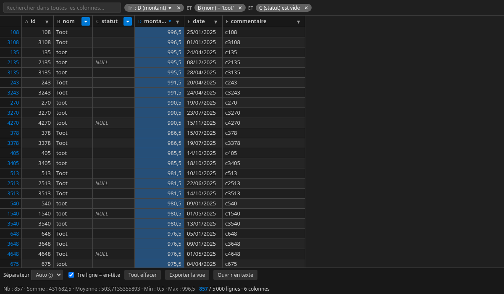

# CSV to Tableur

Extension VS Code qui ouvre les fichiers `.csv` / `.tsv` dans une grille façon Excel.



## Fonctionnalités

- **Grille** : en-tête et numéros de ligne figés, lettres de colonnes (A, B, C…), nombres alignés à droite, `NULL` grisé, défilement virtuel (gros fichiers).
- **Tri** : clic sur le nom de colonne → ▲ croissant → ▼ décroissant → aucun. Le tri reconnaît les nombres (`1,5`, `1 234`), les dates (`31/12/2024`, `2024-12-31`) et le texte (ordre naturel, insensible à la casse). Les vides restent en bas.
- **Filtres façon Excel** (bouton ▾ de chaque colonne) :
  - une condition : égal, différent, contient, commence/finit par, est vide / null, n'est pas vide, `>`, `≥`, `<`, `≤` ;
  - une liste de valeurs à cocher, avec le nombre d'occurrences et une recherche.
  - Les filtres de plusieurs colonnes se cumulent (ET). Exemple : `A = 'toot'` ET `B est vide`.
- **Comptage** en bas à droite (et dans la barre d'état de VS Code) : `lignes affichées / total`.
- **Recherche globale** dans toutes les colonnes.
- **Sélection** à la souris ou au clavier (Maj pour étendre, clic sur une lettre = colonne entière, clic sur un numéro = ligne). Statistiques de la sélection : Nb, Somme, Moyenne, Min, Max.
- **Copier** (Ctrl+C) : la sélection est copiée en tabulations et se colle directement dans Excel.
- **Édition** : double-clic, Entrée, F2 ou frappe directe. Suppr vide les cellules. Ctrl+Z annule (géré par VS Code). La sauvegarde se fait comme pour un fichier texte (Ctrl+S).
- **Séparateur** détecté automatiquement (`,` `;` Tab `|`), modifiable dans le pied de page. Case « 1re ligne = en-tête ».
- **Exporter la vue** : enregistre les lignes filtrées et triées dans un nouveau fichier.
- Redimensionnement des colonnes (glisser le bord ; double-clic = ajustement automatique).
- Bouton « Ouvrir en texte » pour revenir à l'éditeur classique.

## Installation

```sh
npm run package
code --install-extension csv-to-tableur-0.1.0.vsix
```

## Tests

```sh
npm test
```
